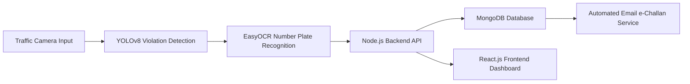

# 🚦 AI-Driven Traffic Violation Detection System

An **AI-powered intelligent traffic monitoring system** that automatically detects traffic violations, extracts vehicle details, generates e-challans, and notifies offenders—minimizing manual enforcement and improving road safety.

---

## 🔗 Live Demo

- **Developer Dashboard**  
  https://traffic-violation.onrender.com/developer  

- **User Dashboard**  
  https://mini-project-ai-driven-traffic-violation.onrender.com/dashboard/

---

## 📸 Project Preview

---

## 🎯 Problem Statement

Urban traffic systems face a growing **road safety and enforcement challenge**:

| 🚨 Challenge | ⚡ Impact |
|-------------|----------|
| Limited manual enforcement | Roads cannot be monitored 24/7 |
| Increasing traffic violations | Helmetless riding, triple riding, red-light jumping |
| Low accountability | Many violations go unpunished |
| Slow penalty process | Manual challan systems are inefficient |

---

## 💡 Proposed Solution

An **AI-driven automated traffic violation detection and reporting system** that operates continuously and scales efficiently.

### 🚀 Key Features

| Feature | Description |
|------|-------------|
| **Real-Time Violation Detection** | Helmet violations, triple riding, red-light jumping |
| **AI Video Analytics** | YOLOv8-based object & behavior detection |
| **Automatic Number Plate Recognition** | Vehicle number extraction using EasyOCR |
| **Automated e-Challan System** | Violation proof and fine sent via email |
| **User Dashboard** | View violation history and evidence |
| **Developer Dashboard** | Monitor logs, violations, and system status |

---

## 🧠 System Architecture

---

## 🛠️ Tech Stack

### 🔹 AI & Machine Learning
- **YOLOv8** – Real-time object & violation detection  
- **EasyOCR** – Automatic number plate recognition  
- **Python** – Model inference and processing  

### 🔹 Backend
- **Node.js** – Backend runtime  
- **Express.js** – REST API framework  
- **Flask** – AI model integration  
- **MongoDB** – Violation and user data storage  

### 🔹 Frontend
- **React.js** – User & developer dashboards  
- **Tailwind CSS** – Responsive UI styling  

### 🔹 Other Tools & Services
- **REST APIs** – Communication between modules  
- **Email Automation** – e-Challan delivery  
- **Cloud Deployment** – Render  

---

## 👥 Team Members

| Name | Role |
|-----|------|
| **Aryan Pratap** | AI model training, Flask integration, violation detection logic, Developer Dashboard |
| **Ishu Agrawal** | Backend API development, database management, OCR pipeline, email automation |
| **Priyanshu Nayak** | Frontend development, User Dashboard, UI/UX design |

---

## 🎓 Academic Details

- **Mentor:** Prof. Yunis Lone  
- **Institute:** GLA University, Mathura  
- **Program:** B.Tech – Computer Science Engineering (AIML & IoT)  
- **Semester:** V  

---

## 📈 Future Enhancements

- 🚀 Speed limit violation detection  
- 🚦 Lane discipline & wrong-way detection  
- 📊 Traffic density analysis  
- 🏛️ Government traffic database integration  
- 📱 Mobile application for vehicle owners  

---

## 🏁 Conclusion

This project demonstrates how **AI, Computer Vision, and Full-Stack Development** can modernize traffic enforcement, reduce human dependency, and improve public safety.

The system is **scalable, automated, and suitable for real-world smart city deployment**.
