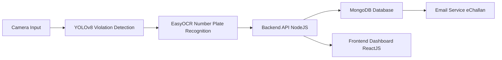

# 🚦 AI-Driven Traffic Violation Detection System

🔗 Live demo:

[Developer Dashboard](https://traffic-violation.onrender.com/developer)

[Frontend Dashboard](https://mini-project-ai-driven-traffic-violation.onrender.com/dashboard/)

### Team Members
- **Aryan Pratap** – AI Model Training, Flask Integration, Core AI Development, Developer Dashboard (using React.js, Node.js, Python(Flask))
- **Ishu Agrawal** – Backend API Development, Database Management, OCR, Email System  
- **Priyanshu Nayak** – Frontend (React.js), User Dashboard, UI/UX  

**Mentor:** Prof. Yunis Lone  
**Institute:** GLA University, Mathura | B.Tech CSE-AIML & IoT (V Sem)

---

## 📌 Problem Statement
Urban roads face a **road safety crisis** due to rising traffic violations:

| 🚨 Issue | ⚡ Impact |
|---------|----------|
| **Manual enforcement is limited** | Police presence cannot cover all roads 24/7 |
| **High violation rate** | Helmet non-compliance, triple-riding, red light jumping |
| **Compromised safety** | Frequent evasion of penalties undermines traffic laws |

---

## 💡 Our Solution
A smarter, AI-powered system that **detects and reports traffic violations automatically**:

| Feature | Description |
|--------|-------------|
| **AI-Powered Surveillance** | Intelligent cameras monitor traffic 24/7 |
| **Real-Time Violation Detection** | Detects helmet violations, triple-riding, red light jumps |
| **Automated Fine Issuance** | Sends e-challans with photo evidence via email |
| **User Dashboard** | Vehicle owners can view/manage their violation records |
| **Developer Dashboard** | Provides admin/developer controls to monitor system status, view logs, and manage violations in real-time |

---

### WorkFlow

### Images

